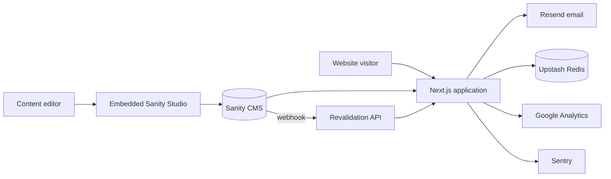

<div align="center">
  

  <p><strong>AI automation and software engineering for ambitious businesses.</strong></p>

  <p>
    <a href="https://arizonix.com">Live website</a>
    |
    <a href="https://arizonix.com/services">Services</a>
    |
    <a href="https://arizonix.com/portfolio">Portfolio</a>
    |
    <a href="https://arizonix.com/contact">Contact</a>
  </p>

  <p>
    
    
    
    
    
  </p>
</div>

## Overview

Arizonix is the production website for an AI automation and software engineering company. It combines a polished, motion-rich marketing experience with a structured Sanity CMS, lead capture, newsletter management, analytics, monitoring, and a performance-focused delivery pipeline.

The application uses the Next.js App Router and server-first rendering. Content fetched from Sanity has resilient static fallbacks where appropriate, while on-demand revalidation keeps published content current without requiring a full deployment.

## Highlights

- **Complete marketing platform** - services, industries, portfolio, case studies, blog, careers, legal pages, and dedicated AI automation content.
- **Headless content management** - embedded Sanity Studio with schemas for services, projects, case studies, posts, testimonials, team members, FAQs, industries, and site settings.
- **Production-ready lead capture** - validated contact forms, honeypot protection, IP rate limiting, confirmation emails, and failed-lead recovery.
- **Compliant newsletter flow** - consent records, signed unsubscribe links, suppression lists, and authenticated administration endpoints.
- **Search and social visibility** - dynamic metadata, JSON-LD, Open Graph images, sitemap, robots directives, canonical URLs, and an RSS feed.
- **Accessible interactions** - semantic structure, skip navigation, reduced-motion support, keyboard-friendly controls, and automated axe checks.
- **Observability and privacy** - consent-aware Google Analytics, Sentry integration, error boundaries, and Web Vitals monitoring.
- **Performance safeguards** - optimized images and package imports, route-level code splitting, bundle budgets, Lighthouse CI, and long-lived asset caching.
- **Security by default** - CSP and security headers, constant-time credential comparisons, protected Studio access, strict input validation, and server-only secrets.

## Technology

| Area                      | Tools                                               |
| ------------------------- | --------------------------------------------------- |
| Framework                 | Next.js 15 App Router, React 18, TypeScript         |
| Styling and motion        | Tailwind CSS, Framer Motion, Lucide React           |
| Content                   | Sanity CMS, Portable Text, Sanity image pipeline    |
| Forms and validation      | React Hook Form, Zod                                |
| Email                     | Resend                                              |
| Storage and rate limiting | Upstash Redis                                       |
| Analytics and monitoring  | Google Analytics 4, Sentry, Web Vitals              |
| Quality                   | ESLint, Prettier, html-validate, axe, Lighthouse CI |
| Delivery                  | GitHub Actions, Vercel                              |

## Architecture



Most pages are server-rendered and use cached Sanity queries. Interactive UI is isolated into client components, and heavier sections are dynamically loaded. API route handlers own form validation, anti-spam controls, rate limiting, email delivery, newsletter persistence, and CMS cache invalidation.

## Getting started

### Prerequisites

- [Node.js](https://nodejs.org/) 22.22.0 or newer
- npm (included with Node.js)
- A [Sanity](https://www.sanity.io/) project
- [Resend](https://resend.com/) and [Upstash Redis](https://upstash.com/) accounts for working forms and newsletter features

### Installation

```bash
git clone <repository-url>
cd Arizonix
npm ci
```

Create the local environment file:

```powershell
Copy-Item .env.example .env.local
```

On macOS or Linux, use `cp .env.example .env.local` instead. Add at least the three required public Sanity values before starting the application:

```dotenv
NEXT_PUBLIC_SANITY_PROJECT_ID=your_project_id
NEXT_PUBLIC_SANITY_DATASET=production
NEXT_PUBLIC_SANITY_API_VERSION=2024-01-01
```

Start the development server:

```bash
npm run dev
```

Open [http://localhost:3000](http://localhost:3000). The content studio is available at [http://localhost:3000/studio](http://localhost:3000/studio) during local development.

> Forms, newsletter subscriptions, revalidation, analytics, and monitoring require their corresponding environment variables. See [Environment variables](docs/environment-variables.md) for the complete reference.

## Environment configuration

Copy `.env.example` and replace every value required by the integrations you enable. Never commit `.env.local` or expose server-side credentials with a `NEXT_PUBLIC_` prefix.

| Group          | Key variables                                                                  | Purpose                                                      |
| -------------- | ------------------------------------------------------------------------------ | ------------------------------------------------------------ |
| Sanity         | `NEXT_PUBLIC_SANITY_*`, `SANITY_API_TOKEN`, `SANITY_REVALIDATE_SECRET`         | CMS reads, editing, and webhook revalidation                 |
| Email          | `RESEND_API_KEY`, `RESEND_FROM_EMAIL`, `RESEND_TO_EMAIL`                       | Contact and newsletter email delivery                        |
| Newsletter     | `COMPANY_POSTAL_ADDRESS`, `NEWSLETTER_UNSUBSCRIBE_SECRET`                      | Compliant email footer and signed unsubscribe links          |
| Redis          | `UPSTASH_REDIS_REST_URL`, `UPSTASH_REDIS_REST_TOKEN`                           | Rate limits, subscribers, suppression, and failed leads      |
| Administration | `NEWSLETTER_ADMIN_TOKEN`, `STUDIO_USERNAME`, `STUDIO_PASSWORD`                 | Protected operational endpoints and production Studio access |
| Analytics      | `NEXT_PUBLIC_GA_MEASUREMENT_ID`                                                | Consent-aware GA4 tracking                                   |
| Monitoring     | `NEXT_PUBLIC_SENTRY_DSN`, `SENTRY_*`                                           | Error reporting and optional source-map uploads              |
| Public links   | `NEXT_PUBLIC_SITE_URL`, `NEXT_PUBLIC_CALENDLY_URL`, `NEXT_PUBLIC_WHATSAPP_URL` | Canonical URLs and optional contact actions                  |

## Available commands

| Command                    | Description                                   |
| -------------------------- | --------------------------------------------- |
| `npm run dev`              | Start the local Next.js development server    |
| `npm run build`            | Create an optimized production build          |
| `npm run start`            | Serve the production build                    |
| `npm run lint`             | Run ESLint with zero warnings allowed         |
| `npm run format`           | Format the repository with Prettier           |
| `npm run format:check`     | Check formatting without changing files       |
| `npm run analyze`          | Build with the client bundle analyzer enabled |
| `npm run lighthouse:local` | Audit the local site with Lighthouse CI       |
| `npm run a11y:axe`         | Run axe against the primary public pages      |
| `npm run html:validate`    | Validate generated application HTML           |

For a complete local quality pass:

```bash
npx tsc --noEmit
npm run lint
npm run build
node scripts/check-bundle-size.mjs
```

The accessibility and Lighthouse commands expect a running application at `http://localhost:3000`.

## Project structure

```text
Arizonix/
|-- app/                    # App Router pages, metadata, and API handlers
|   |-- (marketing)/        # Public marketing routes
|   |-- api/                # Contact, newsletter, admin, and revalidation APIs
|   `-- studio/             # Embedded Sanity Studio
|-- components/
|   |-- analytics/          # Consent-aware analytics components
|   |-- layout/             # Global navigation, footer, and shell
|   |-- monitoring/         # Error and performance instrumentation
|   |-- pages/              # Page-specific presentation components
|   |-- sections/           # Reusable marketing sections
|   |-- seo/                # Structured-data components
|   `-- ui/                 # Shared UI primitives and interactions
|-- hooks/                  # Reusable interaction and animation hooks
|-- lib/                    # Data, integrations, validation, SEO, and utilities
|-- public/                 # Static images and web manifest
|-- sanity/                 # Studio configuration and content schemas
|-- scripts/                # Content seeding and bundle-budget tooling
|-- docs/                   # Operations, QA, security, SEO, and deployment guides
`-- types/                  # Shared TypeScript declarations
```

## Content workflow

1. Open `/studio` locally or the protected production Studio.
2. Create or update a document and publish it.
3. A Sanity webhook calls `/api/revalidate` with `SANITY_REVALIDATE_SECRET`.
4. The matching Next.js cache tag is invalidated and fresh content is served.

The Studio supports services, portfolio projects, case studies, blog posts, testimonials, team members, FAQ items, industries, and singleton site settings. To populate starter website-development content, configure Sanity credentials and run:

```bash
node scripts/seed-website-development.mjs
```

## API surface

| Endpoint                      | Method        | Responsibility                                          |
| ----------------------------- | ------------- | ------------------------------------------------------- |
| `/api/contact`                | `POST`        | Validate and deliver project inquiries                  |
| `/api/newsletter`             | `POST`        | Record consent and send subscription confirmation       |
| `/api/newsletter`             | `GET`         | Return subscriber count with bearer-token authorization |
| `/api/newsletter/unsubscribe` | `GET`, `POST` | Verify signed links and process unsubscribe requests    |
| `/api/admin/failed-leads`     | `GET`         | Retrieve failed contact deliveries for recovery         |
| `/api/revalidate`             | `POST`        | Invalidate CMS cache tags from a Sanity webhook         |

Administrative endpoints fail closed when their secrets are not configured. Treat all returned lead data as sensitive.

## Quality and CI

GitHub Actions runs type checking, linting, production builds, bundle-size validation, route smoke tests, and Lighthouse audits. The repository also maintains explicit accessibility, security, performance, and launch checklists.

Current documented desktop targets are at least 95 for Lighthouse Performance and Best Practices, and 100 for Accessibility and SEO. See the performance report for measured results and the remaining mobile optimization work.

## Deployment

The application is designed for Vercel:

1. Import the repository into Vercel.
2. Use `npm ci` as the install command and `npm run build` as the build command.
3. Configure the variables documented in `.env.example` for Preview and Production.
4. Add the production domain and configure Sanity CORS origins.
5. Verify the Resend sending domain and create the Sanity revalidation webhook.
6. Set strong `STUDIO_USERNAME` and `STUDIO_PASSWORD` values before exposing `/studio`.

Follow the [deployment guide](docs/deployment-guide.md) for DNS, webhook, rollback, and post-deployment checks.

## Documentation

- [Environment variables](docs/environment-variables.md)
- [Deployment guide](docs/deployment-guide.md)
- [SEO setup](docs/seo-setup.md)
- [Accessibility audit](docs/accessibility-audit.md)
- [Performance budget](docs/performance-budget.md)
- [Security notes](docs/security-notes.md)
- [QA checklist](docs/qa-checklist.md)

## Contributing

1. Create a focused branch from `main`.
2. Keep changes typed, accessible, responsive, and consistent with the existing component system.
3. Run the type check, linter, production build, and any relevant audits.
4. Update documentation and `.env.example` when configuration changes.
5. Open a pull request with a clear summary and verification notes.

This is a private project. Do not redistribute source code, content, credentials, or customer data without authorization.

---

<div align="center">
  Built by <a href="https://arizonix.com">Arizonix</a> | Intelligent software, engineered for growth.
</div>
